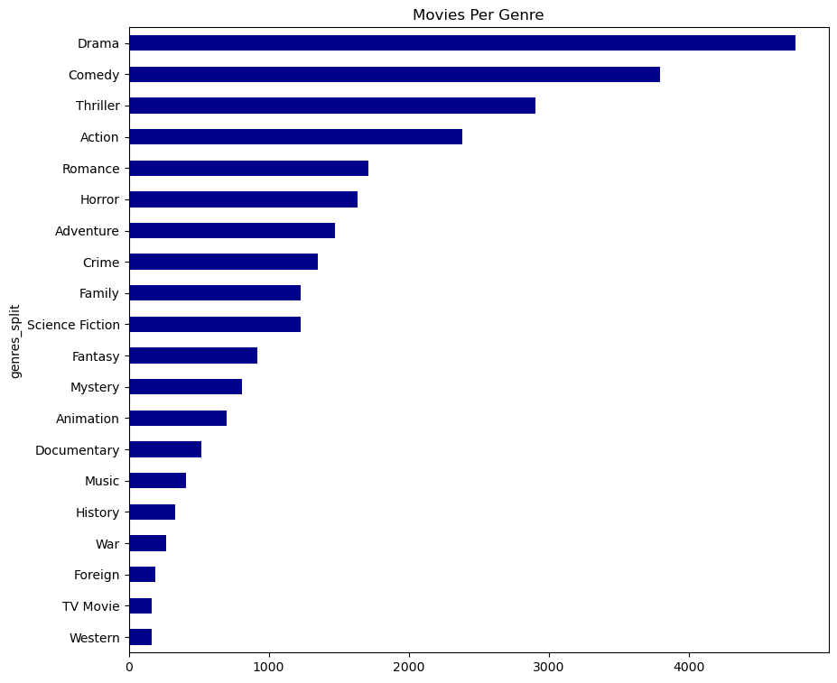
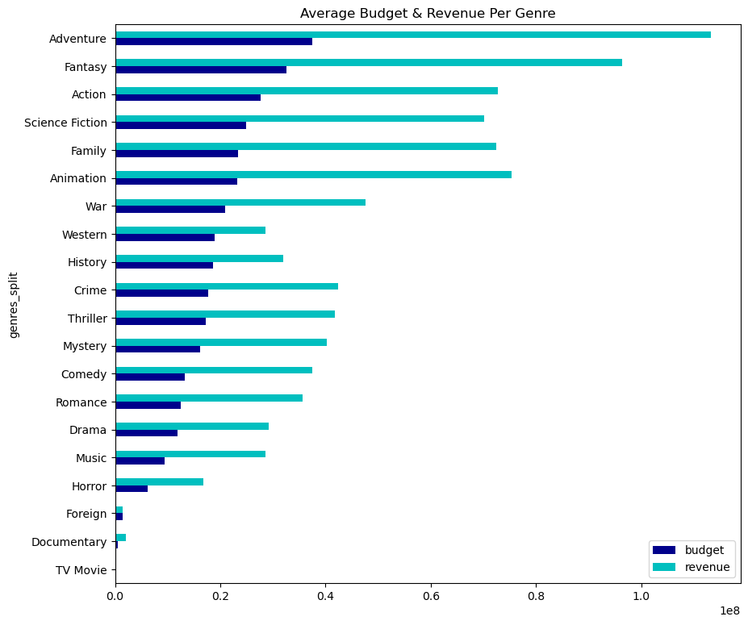
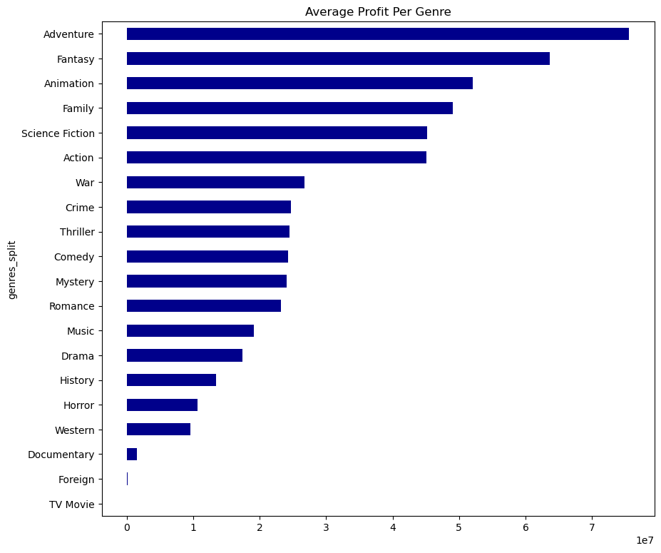
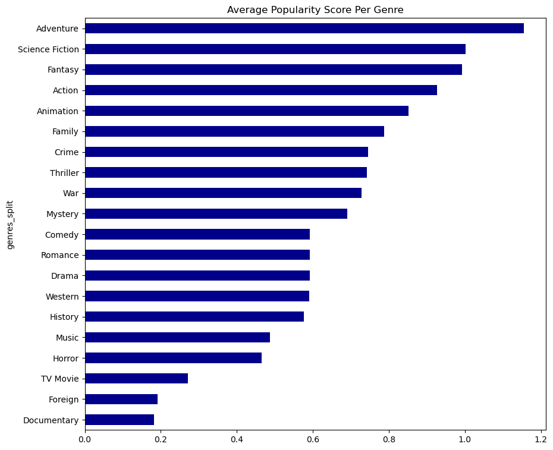
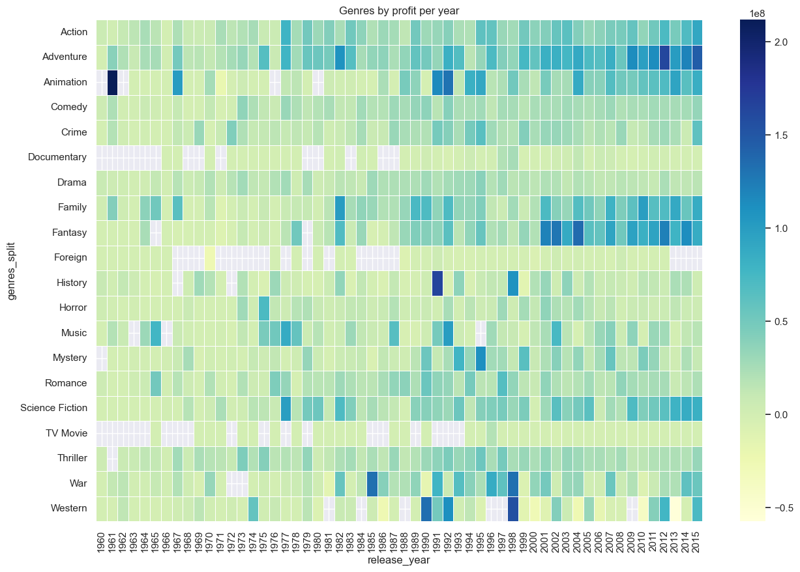
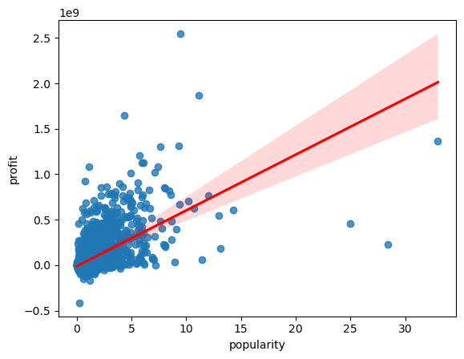
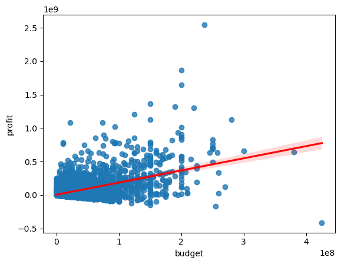
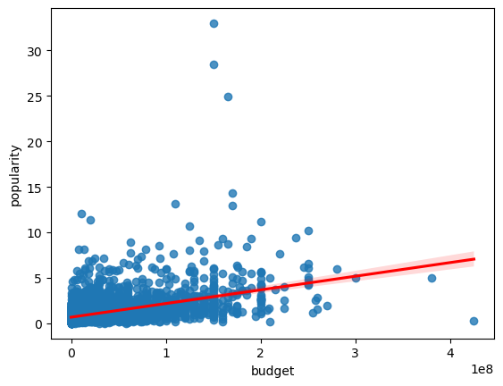

# 🎬 Movie Genre Data Analysis

An exploratory data analysis of **10,866 movies (1960–2015)** in Python and pandas, focused on **genres**. The project asks which genres get made the most, which ones cost and earn the most, which ones audiences like best, and whether big budgets, high ratings or popularity actually line up with box-office success.

---

## 📌 Research Questions

1. Which genres are the most common (number of movies made)?
2. Which genres have the highest average budget and revenue?
   - 2.5 Which genres have the best average profit?
3. Which genres have the highest average popularity?

## 🧪 Hypotheses

1. The best movies by **vote average** return high profit and revenue.
2. The best movies by **popularity** return high profit and revenue.
3. Movies with **high budgets** return high revenue and profit.
4. Movies with **high budgets** have high popularity.

---

## 📂 Dataset

- **Source:** TMDb movie dataset (`imdb_movies.csv`) _[TODO: add the link to where you downloaded it]_
- **Size:** 10,866 rows × 21 columns
- **Columns used:** `genres`, `budget`, `revenue`, `popularity`, `vote_count`, `vote_average`, `runtime`, `release_year`
- **Engineered column:** `profit = revenue - budget`

## 🛠️ Tools

- **Python** and **Jupyter Notebook**
- **pandas** for cleaning, reshaping and aggregating
- **Matplotlib** and **Seaborn** for bar charts, pie charts, regression plots and the heatmap

---

## 🔄 Process

1. **Inspect:** reviewed the structure, data types and null counts with `info()`.
2. **Clean:**
   - Removed duplicate rows.
   - Dropped movies with no genre listed (23 rows).
   - Kept only the columns needed for the analysis.
3. **Feature engineering:** created a `profit` column from revenue minus budget.
4. **Reshape genres:** many movies list several genres, e.g. `Action|Adventure|Science Fiction`. I split that column and stacked it so each movie counts once toward *every* genre it belongs to.
5. **Analyze:** grouped by genre to calculate counts and average budget, revenue, profit, popularity and rating.
6. **Test hypotheses:** used Spearman correlations and Seaborn regression plots, limited to movies with **50+ votes** so that ratings from just a handful of voters don't skew the results.

---

## 📊 Findings: Research Questions

### Q1: Most common genres



| Rank | Genre | Movies |
|---|---|---|
| 1 | Drama | 4,760 |
| 2 | Comedy | 3,793 |
| 3 | Thriller | 2,907 |
| 4 | Action | 2,384 |
| 5 | Romance | 1,712 |

**Drama and Comedy dominate.** The least common genres are Western (165), TV Movie (167) and Foreign (188).

### Q2: Highest average budget and revenue



| Genre | Avg. Budget | Avg. Revenue |
|---|---|---|
| Adventure | $37.5M | $113.1M |
| Fantasy | $32.6M | $96.3M |
| Action | $27.7M | $72.8M |
| Animation | $23.2M | $75.3M |
| Family | $23.4M | $72.4M |

### Q2.5: Highest average profit



**Adventure** ($75.6M), **Fantasy** ($63.7M), **Animation** ($52.1M), **Family** ($49.1M) and **Science Fiction** ($45.2M) lead in average profit. **TV Movie** is the only genre with a negative average profit.

### Q3: Highest average popularity



**Adventure** (1.15), **Science Fiction** (1.00), **Fantasy** (0.99), **Action** (0.93) and **Animation** (0.85) lead. These are the same big-budget blockbuster genres that lead in revenue.

### Bonus: Profit by genre over time



Adventure, Fantasy, Family and Animation get noticeably more profitable from the 2000s on, which matches the rise of franchise and blockbuster films.

---

## 🧪 Findings: Hypotheses

Spearman correlations, using movies with 50+ votes:

| # | Hypothesis | Correlation | Result |
|---|---|---|---|
| H1 | High vote average → high profit / revenue | 0.20 / 0.11 | ❌ **Not supported** (weak) |
| H2 | High popularity → high profit / revenue | 0.50 / 0.59 | ✅ **Supported** (moderate) |
| H3 | High budget → high revenue / profit | 0.71 / 0.33 | ⚠️ **Partly supported**: strong for revenue, weak for profit |
| H4 | High budget → high popularity | 0.48 | ✅ **Supported** (moderate) |

<p float="left">
  
  
  
  
</p>

**Takeaway:** spending more reliably brings in more revenue, but not proportionally more profit. Popularity predicts box-office success much better than ratings do: a well-rated movie isn't necessarily a money-maker.

---

## ⚠️ Limitations

- **$0 budgets and revenues:** many movies list $0 for budget and/or revenue, which really means the value is missing. These pull the averages down, especially for small genres like Documentary, Foreign and TV Movie.
- **No inflation adjustment:** dollar figures aren't adjusted for inflation, even though the dataset has `budget_adj` and `revenue_adj` columns that could be used.
- **Multi-genre movies count more than once:** because of the genre split, a movie tagged Action|Adventure counts toward both genres.
- **Correlation isn't causation:** these relationships describe patterns in the data. They don't show that one thing causes another.

## 🔮 Next Steps

- Rerun the analysis without the $0 budget and revenue rows, and using the inflation-adjusted columns.
- Look at return on investment (profit ÷ budget) by genre instead of raw profit.
- Break out trends by decade.

---

## ▶️ How to Run

```bash
git clone https://github.com/EvanBaker19/movie_genre_analysis.git
cd movie_genre_analysis
pip install pandas matplotlib seaborn jupyter
jupyter notebook Movie.ipynb
```

> Update the CSV path in the notebook to wherever `imdb_movies.csv` lives on your machine.

---

## 👤 Author

**Evan Baker**
- GitHub: [@EvanBaker19](https://github.com/EvanBaker19)
- Portfolio: [datascienceportfol.io/ecbaker2004](https://datascienceportfol.io/ecbaker2004)
